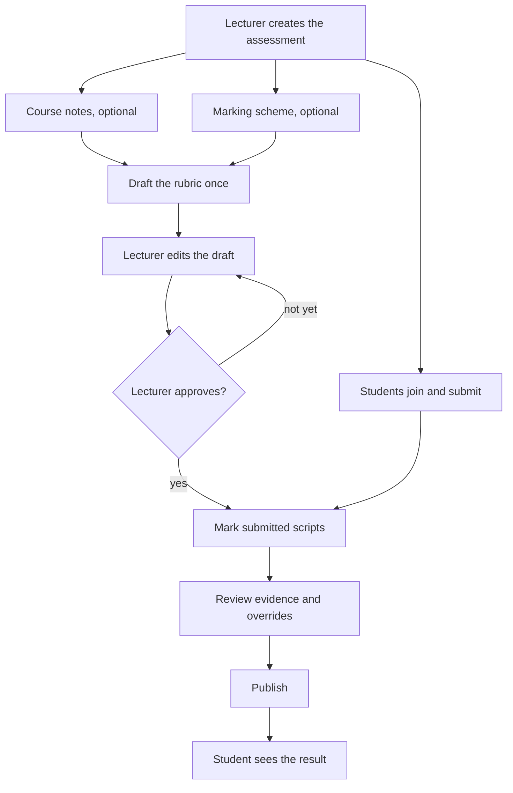

# Markwise

## What it is

Lecturers set an assignment, test, or exam. Students join with a code and
submit typed answers or one PDF script. The model drafts a rubric once. The
lecturer edits and approves it before any marking. Marking uses only that
approved rubric. The lecturer reviews the evidence, can override a point,
then publishes. Students see their result. Excel export is one sheet named
Results, with Name, Matric number, and Score (out of N). The principle: the
AI drafts, the lecturer decides.

## Who it is for

Lecturers who have to defend a mark, and students who should see why they
received it. Built for the Meta Global AI Developer Hackathon, startup
track.

## How it works

Where a scheme exists, it is authoritative for the points and the mark
split. Notes are not re-read for each script.

## Meta models

The product model is muse-spark-1.3 on the Meta Model API, an
OpenAI-compatible Responses API at https://api.meta.ai/v1. It is used four
ways:

- Rubric drafting: a tool-using agent searches the notes. Every point
  carries a citation (a quote, file, and page). Code checks that the quote
  is really in the notes.
- Answer location: one call returns the opening words of each answer. Code
  checks those words are in the script, then slices it. An answer it cannot
  locate is left empty and treated as missing.
- Marking: a tool-using agent marks only the approved rubric. Every mark
  above 0 must quote the student's words. Code checks that the quote is in
  the answer. Anything it cannot judge is flagged.
- Handwriting: a PDF page with almost no extractable text is rendered to an
  image. The same model transcribes it and writes [illegible] for a word it
  cannot read. The normal pipeline then runs.

The codebase was built with Muse Code, model
muse-spark-1.3-contributor.

## Stack

`web/` is Next.js 16 with TypeScript and Tailwind 4, talking to Supabase
with the publishable key only; `worker/` is Python, calling the Meta Model
API over HTTPS; Supabase provides Postgres, Auth, and Storage, with the
schema in `web/supabase/schema.sql`.

## Accuracy

- Notes only, before lecturer approval, 12 synthetic BIO101 scripts
  (48 question pairs): 60.4% exact, 89.6% within 1 mark, mean absolute
  difference 0.49 per question. Source:
  `evals/results/bio101-test1_20261030_185709.json`.
- Same 12 scripts with the lecturer's marking scheme and calibrated
  accept/reject: 100% exact. This is calibration on these scripts, not
  accuracy on unseen students. Source:
  `evals/results/bio101-test1_20261028_222916.json`.

The draft is a starting point, and lecturer approval is the product.

## Cost

A typed or text-PDF script of 5 questions (25 marks) used about 13,800
input and 4,700 output tokens to mark, plus a small answer-location call:
about 20,000 tokens. Drafting a rubric from 2 pages of notes used about
182,000 input and 51,000 output tokens across about 30 turns, because the
agent adds about one point per turn. A two-page handwritten script is the
expensive path: vision was about 4,900 input and 4,200 output tokens, then
marking took 27 turns and about 152,000 input and 55,000 output tokens.

## Run it

- Create a Supabase project. In the SQL editor, run
  `web/supabase/schema.sql` as a new query.
- Worker: copy `.env.example` to `.env` and fill `MODEL_API_KEY`,
  `MODEL_BASE_URL` (https://api.meta.ai/v1), `MODEL_NAME`
  (muse-spark-1.3), `SUPABASE_URL`, and `SUPABASE_SECRET_KEY`. The secret
  key stays in that root `.env` only. Optional: `VISION_MODEL`,
  `MAX_VISION_PAGES`.
- Web: copy `web/.env.example` to `web/.env.local` and fill
  `NEXT_PUBLIC_SUPABASE_URL` and `NEXT_PUBLIC_SUPABASE_PUBLISHABLE_KEY`
  only.
- Python 3.14 virtualenv, `pip install -r worker/requirements.txt`, then
  `python -m worker.jobs` from the repo root. Tests:
  `python -m unittest discover -s worker/tests -t .`
- Web: `cd web && npm install && npm run dev`, then open
  http://localhost:3000. `npm run build` checks the app.

## Limitations

Rubric caps apply per question, so a rule like "these reasons count for at
most N" cannot be expressed. Matric numbers are not format-checked. The
rubric cannot be changed after marking has started, and there is no re-mark
after a rubric change. Rubric drafting and handwritten scripts use many
more tokens than a typed script.
